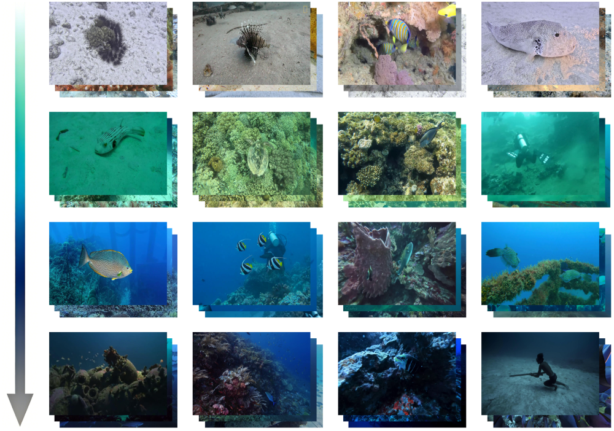
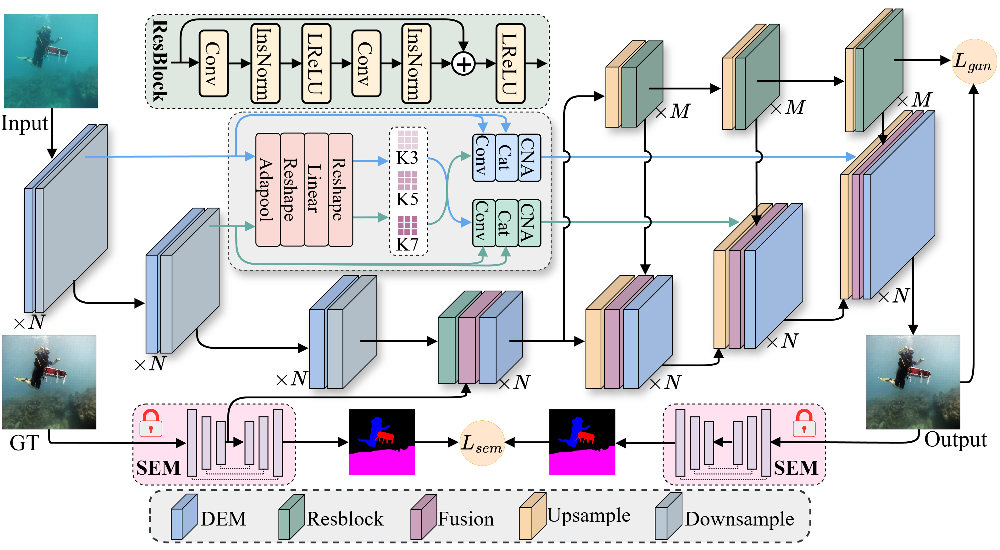

S-GAN 

This repository is the official PyTorch implementation of S-GAN. S-GAN achieves **state-of-the-art performance** in image quality and underwater image enhancement task. 

:rocket::rocket::rocket:News: 

- 2026/9/30   We released the official code of S-GAN. 

- 2026/10/27 We released the official TFUI dataset. 

---

### The samples of TFUI dataseted

## The architecture of S-GAN

## :rocket: Our TFUI dataset can be obtained by [Google](https://drive.google.com/file/d/1YmR1jEeqnpmpx5IdW-sSorRkOpSJjpla/view?usp=drive_link) , welcome to use it.

## :rocket: The offical weight of S-GAN can be obtained by [Google](https://drive.google.com/file/d/1rD2T2h3BnptaD_nI3VbBKCpcSeT8T9Nm/view?usp=drive_link) .

==use:== Create `weight` fold, and put the `s-gan.pth` in it.

## :rocket: Train and inference

- Our code is independent and complete. You can run `train.py` or `test.py` directly to execute S-GAN. The only thing you should pay attention to is modifying the paths in the code. 
- The main packages of S-GAN are Pytorch=\=2.1.1, cuda=\=12.1, and python==3.11. 

